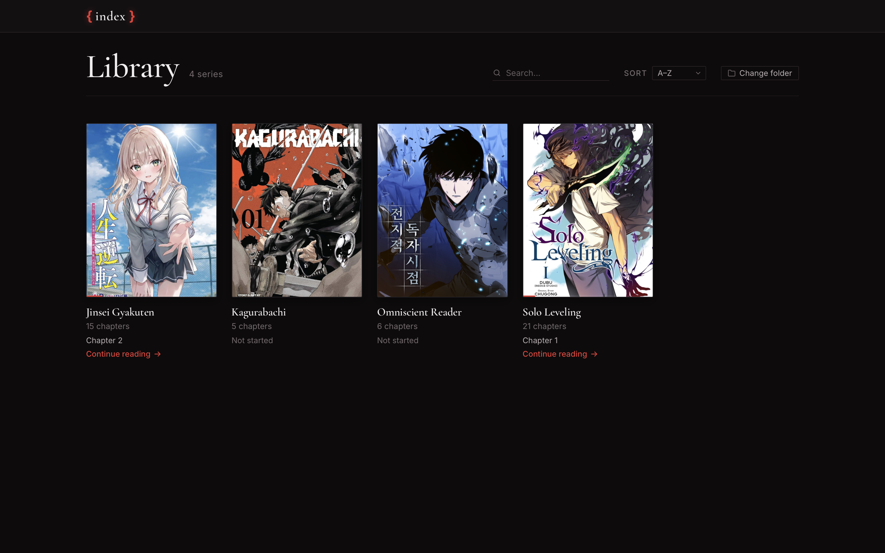
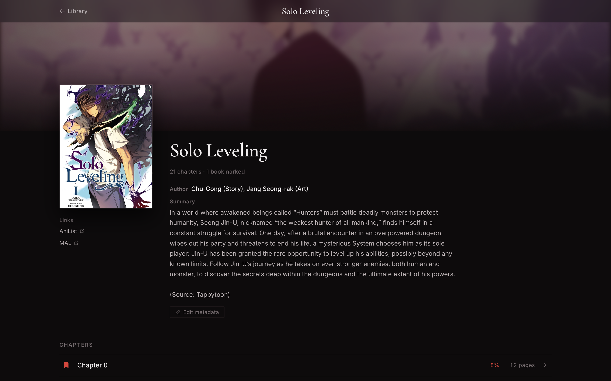
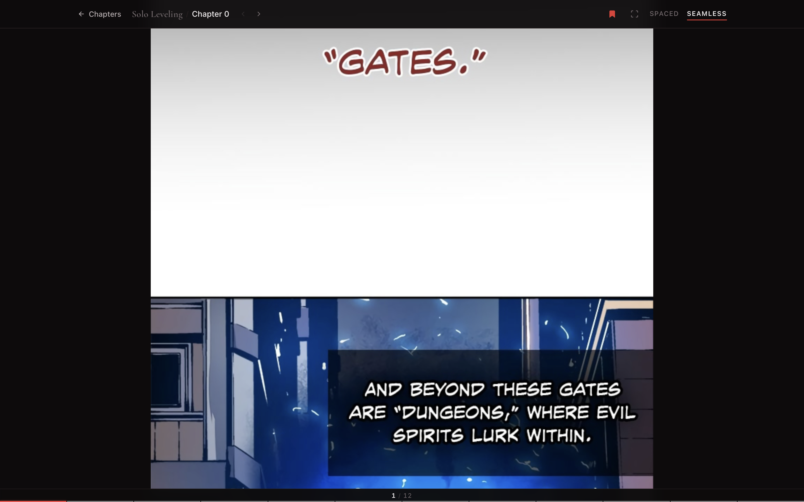
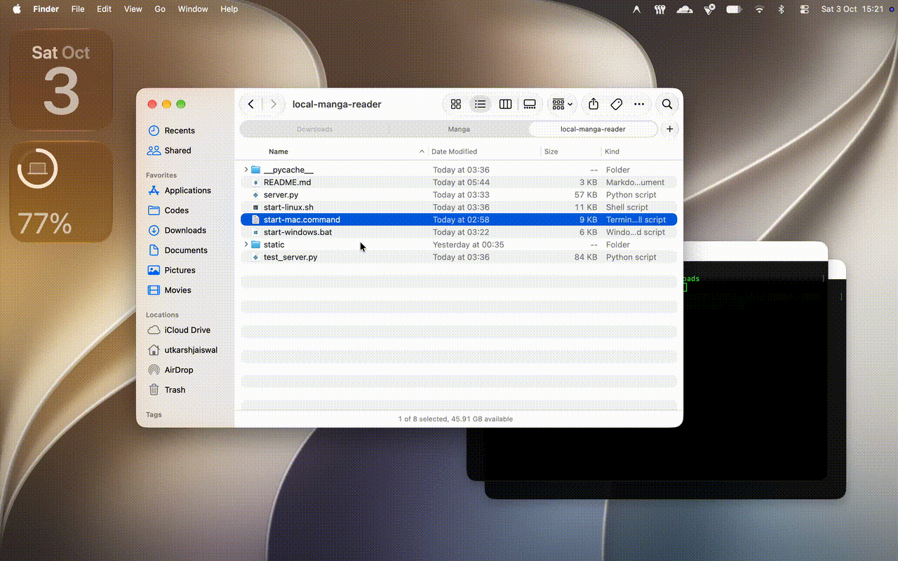

# { index }

A lightweight, zero-dependency local manga and manhwa reader that runs in your web browser.

## Features

- **Continuous Vertical Reading**: Smooth scrolling optimized for both traditional manga and webtoons/manhwa.
- **Spaced & Seamless Modes**: Switch between discrete pages with margins or a seamless edge-to-edge strip.
- **Folder & Archive Support**: Reads chapter folders directly alongside `.cbz` and `.zip` archives without extracting them.
- **Remote Reading**: Supports streaming manga and manhwa from supported online sources, allowing you to read remote content directly in the app without downloading it manually first.
- **Reading Progress & Resume**: Automatically saves your position as you scroll and resumes where you left off.
- **Segmented Timeline**: Interactive bottom progress bar with page previews and instant jump navigation.
- **Library Organization**: Instant search, unified sorting (by Name, Chapters, or Unread count), and chapter order toggle.
- **Series Customization**: Custom covers, hero backdrops, synopsis, and external links.
- **Dark Editorial Themes**: Minimalist Crimson and Kuromi dark themes with custom user profiles.
- **Keyboard Shortcuts**: Complete hands-free keyboard navigation.

## Preview









## Quick Start

### Prerequisites
- **Python 3.10+**
- A modern web browser
- No third-party packages or build steps required (`pip`, `npm`, etc. are not needed)

### Starting the App

- **macOS**: Double-click `start-mac.command`. It starts the server and opens the app in Safari.
- **Windows**: Double-click `start-windows.bat`. It starts the server and opens your default browser.
- **Linux**: Run `./start-linux.sh` in a terminal to launch the server and open your default browser.

#### Manual Startup
You can also start the server manually from any terminal:

```bash
python3 server.py
```

Once running, open your browser and navigate to:
```
http://localhost:8000
```

### First Launch
When opening the app for the first time without a configured library, it starts in a clean setup state. Simply click **Choose another folder** to select your manga folder.

## Manga Library Structure

Your manga folder can live anywhere on your computer (including external drives) and follows a simple structure:

```text
Manga/
├── Solo Leveling/
│   ├── cover.jpg           # (Optional) Custom cover
│   ├── background.jpg      # (Optional) Custom hero backdrop
│   ├── Chapter 01/         # Folder chapter containing images
│   │   ├── 001.jpg
│   │   ├── 002.jpg
│   │   └── ...
│   └── Chapter 02.cbz      # Archive chapter (.cbz or .zip)
└── Kagurabachi/
    ├── Chapter 01.zip
    └── Chapter 02.zip
```

- Each subfolder in your library represents a manga series.
- Chapters can be standard subfolders with images, `.cbz` files, or `.zip` archives.
- `cover.jpg` and `background.jpg` are optional. If omitted, covers are automatically generated from chapter pages.
- Reading progress, bookmarks, and metadata are saved per-series inside a hidden `.reader` folder.

## Changing Library Folder

You can choose or switch your manga library folder at any time directly inside the app:
- **Type or Paste a Path**: Open **Settings** from the profile menu and enter the full filesystem path (e.g. `/Users/yourname/Manga`) into the **Switch Library Folder** field, then click **Apply** or press **Enter**.
- **Browse with Folder Picker**: Click **Browse folder** in Settings (or **Choose another folder** on the library screen) to select a directory using your native system dialog.
- **Validation & Error Handling**: Invalid, nonexistent, or file paths show an inline error message without switching the active library or modifying your saved configuration, allowing you to correct the path and retry.
- **Per-Library Pins Preserved**: Switching libraries immediately loads that collection's pinned series and keeps pin lists completely isolated between libraries.
- **Persistent Selection**: Your chosen library is remembered automatically in `settings.json` for future launches, while the CLI `--dir` override remains temporary for that server session only.

## CLI Reference

You can pass command-line arguments when launching via `python3 server.py` (or `python3 main.py`):

```bash
# Start server with your saved library folder
python3 server.py

# Directly open a remote manga or manhwa URL in the reader
python3 server.py "https://nhentai.net/g/686216/"
python3 main.py "https://weebcentral.com/series/01J76XY8CM99/chainsaw-man"

# Temporarily use another manga folder for this session only (does not change your saved library)
python3 server.py --dir /path/to/manga

# Run on a custom port
python3 server.py --port 9000

# View all options
python3 server.py --help
```

- `url`: Optional supported remote manga/manhwa URL (e.g. nhentai, WeebCentral) to open directly in the reader on startup.
- `--dir <path>`: Temporarily overrides the active library for that server session without modifying your saved settings.
- `--port <port>`: Changes the port the server listens on (default: `8000`).

## Reading / Keyboard Shortcuts

### Keyboard Shortcuts Reference Overlay
Press **`Shift + /`** or **`?`** from anywhere in the app (Library view, Series detail, or Reader view) to open the interactive **Keyboard Shortcuts** overlay. It can also be opened via the Profile dropdown menu. The overlay displays implemented shortcuts grouped by context (**Reader navigation**, **Reading controls**, and **Zoom and screenshots**), highlighting shortcuts active in the current view. The overlay can be dismissed with **`Escape`**, the close button, or clicking the backdrop.

### Reading Modes & Controls
- **Spaced Mode**: Adds spacing and subtle borders between pages, ideal for traditional Japanese manga.
- **Seamless Mode**: Strips all padding and borders for a continuous unbroken scroll, ideal for Korean manhwa and webtoons.
- **Fixed Translucent Header**: The reader header stays pinned with a subtle blur effect as you scroll, keeping navigation, chapter title, zoom, reading mode, and fullscreen controls accessible without obstructing artwork.
- **Chapters Button**: Seamlessly navigates back to the series chapter list from the reader header, cleanly exiting fullscreen first if active.
- **Smooth & Continuous Scrolling**: Press or hold the Up/Down arrow keys for continuous, fluid reading scrolling.

### Keyboard Shortcuts

| Key | Action | Context |
| :--- | :--- | :--- |
| `Left Arrow` | Go to previous chapter | Reader view |
| `Right Arrow` | Go to next chapter | Reader view |
| `Up Arrow` | Scroll up through the current chapter (hold for continuous scroll) | Reader view |
| `Down Arrow` | Scroll down through the current chapter (hold for continuous scroll) | Reader view |
| `Shift + Up Arrow` | Jump to the top of the chapter | Reader view |
| `Shift + Down Arrow` | Jump to the bottom of the chapter | Reader view |
| `F` | Toggle fullscreen | Reader view |
| `B` | Toggle chapter bookmark | Reader view |
| `Shift + R` | Toggle chapter Read / Unread status | Reader view |
| `Shift + S` | Toggle Spaced / Seamless reading mode | Reader view |
| `S` | Save currently displayed page screenshot to `<Library>/Screenshots/` | Reader view |
| `=` / `+` | Zoom in by 10% (50% to 300% range, temporary) | Reader view |
| `-` | Zoom out by 10% (50% to 300% range, temporary) | Reader view |
| `0` | Reset zoom to 100% (temporary) | Reader view |
| `Shift + /` / `?` | Toggle keyboard shortcuts reference overlay | All views |
| `Escape` | Exit fullscreen / close active modal or dropdown / return to series view | All views |

> **Note on Zoom**: Zooming is a temporary viewing adjustment with a range of 50% to 300% (default 100%). It adjusts manga page images only, persists across entering/exiting fullscreen within the same chapter session, and resets to 100% when navigating to another chapter or exiting the reader view. Zoom state is never stored in local storage, server settings, or series preferences.

### Page Screenshots (`S`)
Pressing `S` captures the currently visible manga page in its original source resolution and saves it cleanly to:
```text
<Library Folder>/Screenshots/<Series Name>/<Chapter Name>_p<Page Number>_<Timestamp>.png
```
For remote manga streams, screenshots are automatically saved to your configured library's screenshot directory, or downloaded via the browser if no local library is set.

## Library & Organization

- **Per-Library Pinned Series**: Pin your favorite series to keep them anchored at the top of your library for quick access. Pinned series are persisted independently for each library folder using canonical filesystem paths. Switching libraries immediately displays only that library's own pinned series and never mixes pinned series across collections.
- **Temporary CLI Library Overrides (`--dir`)**: Specifying `--dir <path>` uses the pin list associated with that temporary library during the session without modifying your saved default library configuration in `settings.json`.
- **Unified Sorting**: Sort by Name, Chapters, or Unread count with a single click.
- **Centered Series Header**: The manga title in the series view header is centered relative to the viewport with smart ellipsis truncation on narrow screens.

## Application Data & Storage Locations

`{ index }` separates your manga library files from application configuration and state:

### Global Configuration & Remote State
Application settings (`settings.json`), user profiles (`profile.json`, `avatar.jpg`), and remote reading progress (`remote_reader_data.json`) are stored in OS-standard application data directories:
- **macOS**: `~/Library/Application Support/LocalMangaReader/`
- **Windows**: `%APPDATA%\LocalMangaReader\` (typically `C:\Users\<User>\AppData\Roaming\LocalMangaReader\`)
- **Linux**: `~/.config/LocalMangaReader/` (or `$XDG_CONFIG_HOME/LocalMangaReader/`)

### Per-Series Local Data
Reading progress, chapter completion status, bookmarks, and series display preferences for local manga are stored inside a hidden folder within each series:
```text
<Library>/<Series Name>/.reader/reader_data.json
```
Your original manga image files and archives (`.cbz`/`.zip`) are **never modified, renamed, or extracted**.

## Known Limitations

- **Safari Fullscreen Scroll Restoration**: When exiting fullscreen in Safari (macOS / WebKit), Safari's internal viewport restoration behavior may return the scroll position to where you were before entering fullscreen. Chrome, Edge, and Firefox preserve the active reading position correctly. If reading on Safari, scrolling or using page bookmarks before exiting fullscreen helps track your position.
- **Upstream Cloudflare Protection**: When reading remote manga (e.g. WeebCentral, nhentai), upstream Cloudflare bot-protection or captcha challenge pages (HTTP 403 / 503) may temporarily prevent streaming until the upstream site relaxes verification.

## Basic Troubleshooting

- **Python is not installed or version is too old**: Ensure Python 3.10 or higher is installed (`python3 --version`). You can download it from [python.org](https://www.python.org).
- **Launcher permission error (macOS / Linux)**: If the launcher script fails to run, make it executable in your terminal:
  - macOS: `chmod +x start-mac.command`
  - Linux: `chmod +x start-linux.sh`
- **Port already in use**: If port `8000` is being used by another application, run with a different port (e.g. `python3 server.py --port 8080`, or `PORT=8080 ./start-mac.command` on macOS).
- **Browser does not open automatically**: Open your browser manually and visit `http://localhost:8000`.

## Data & Privacy

- **Local & Private**: The reader runs entirely on your computer. Your manga files and reading data stay local.
- **Non-Destructive**: Your manga files and archives are never moved, renamed, extracted, or altered.
